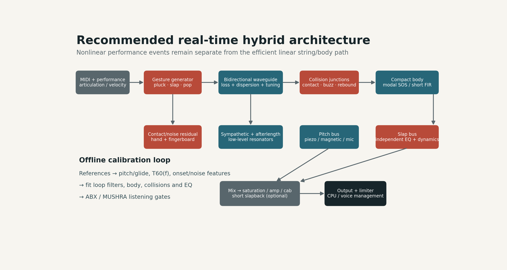
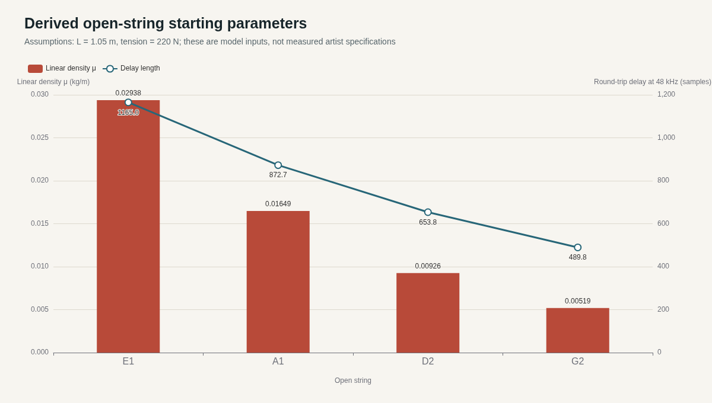

# Psychobilly Slap Double Bass for VST Synthesis

## Executive Summary

The recommended instrument is a **hybrid physical model**: a bidirectional digital-waveguide string with frequency-dependent loss, fractional-delay tuning, optional stiffness dispersion, nonlinear string–fingerboard collision junctions, and amplitude-dependent pitch glide, followed by a compact measured or fitted body response. This is preferable to both a minimal Karplus–Strong loop and a full finite-element instrument. A single delay loop is highly efficient for a linear plucked string, but essential slap behaviour is nonlinear and time-varying; bidirectional waveguides are the appropriate formulation when those effects matter ([Välimäki et al.](http://users.spa.aalto.fi/vpv/publications/cmj98.pdf)). Full distributed contact simulation is scientifically valuable but computationally demanding, making it better suited to an offline reference solver than a first real-time plug-in ([Bilbao](https://arxiv.org/pdf/1405.2589)).

The psychobilly identity should not be delegated to a generic “slap noise” sample layered over an ordinary bass. The model must distinguish a normal outward pluck, a hard outward **pop/snap** whose string rebounds against the fingerboard, an inward percussive **slap**, and unpitched hand/string hits between notes. A directly relevant waveguide study models pop with a large outward pull and release, slap with a rapid inward force and initial velocity, and collisions with nonlinear scattering junctions that can occur at several points along the fingerboard ([Evangelista & Eckerholm](https://www.diva-portal.org/smash/get/diva2:316228/FULLTEXT01.pdf)). The output should then split into **pitch** and **slap** buses, reflecting the practical distinction between the instrument’s pitched/f-hole component and its fingerboard/percussive component ([No Treble](https://www.notreble.com/buzz/2010/03/01/upright-slap-bass-rockabillypsychobilly-instrument-setup-and-equipment/)).

The named references should be treated as calibration targets rather than invented presets. Use **Steve Whitehouse/Frenzy**, **Oliver Baroni/Hillbilly Moon Explosion**, and era-specific **Demented Are Go** recordings. Demented Are Go is a band, not one bassist: *In Sickness & In Health* credits Ray Thompson, while *Kicked Out of Hell* credits Graeme Grant ([Discogs](https://www.discogs.com/release/1918377-Demented-Are-Go-In-Sickness-And-In-Health-Kicked-Out-Of-Hell)). No claim is made here that a particular pickup, string set, amplifier, EQ curve, or compressor setting was used on those records unless a source explicitly documents it. The report therefore supplies physically motivated starting values and a measurement/listening workflow, not falsely precise “artist settings.”



## 1. Design Target and Reference Corpus

### 1.1 What the VST must reproduce

The playable instrument needs more than three static timbres. **Pizzicato** is an outward displacement followed by release, with brightness controlled by pluck position, finger contact, and velocity. **Pop** is a larger outward pull that creates a sharp attack, fingerboard rebound, contact buzz, and often a stronger onset pitch excursion. **Slap** includes both an inward strike and a family of rhythmic hand sounds; it may be pitched, muted, or almost entirely percussive. On double bass, hard pizzicato can make the released string bounce off the fingerboard, while additional percussive sounds are made by smacking the strings between notes ([Slapping overview](https://en.wikipedia.org/wiki/Slapping_(music))). The formal snap-pizzicato gesture similarly lifts the string so that it snaps back onto the fingerboard ([Vienna Symphonic Library](https://www.vsl.co.at/academy/strings/double-bass)).

The performance interface should consequently expose **articulation, velocity, pluck position, strike position, left-hand stopping position, action, contact stiffness, contact damping, and mute amount**, rather than only “slap level.” MIDI note and velocity can determine the basic gesture, while a keyswitch, CC, or articulation lane selects pluck/slap/pop/ghost. Random variation should affect finger noise, exact contact time, and secondary impacts without moving the principal note timing. Repetition on the same string must preserve or deliberately damp existing energy; retriggering a cleared delay line destroys one of the important cues of rapid psychobilly playing. Sympathetic ringing, afterlength resonances, and body thumps should be quiet dependent layers, not independent constant ambience.

### 1.2 Reference recordings and what to measure

For Whitehouse, begin with Frenzy’s *Clockwork Toy* era, including **“I See Red,” “Misdemeanour,” and “Nobody’s Business,”** then compare a later recording to avoid mistaking one production chain for his entire playing sound. Frenzy was formed by bassist/vocalist Steve Whitehouse, and *Clockwork Toy* was released in 1986 ([Frenzy history](https://en.wikipedia.org/wiki/Frenzy_(band))). A dedicated Steve Whitehouse slap-technique video provides a performance-view supplement to the mixed records ([Slapstream](https://www.youtube.com/watch?v=j06KhEvvnXI)). For Baroni, use selected Hillbilly Moon Explosion recordings plus the dedicated slap-bass discussion/performance video ([Baroni Slapstream](https://www.youtube.com/watch?v=OqQOrKB7mGo)); Baroni is the group’s upright bassist and co-founder ([Hillbilly Moon Explosion](https://en.wikipedia.org/wiki/Hillbilly_Moon_Explosion)).

For Demented Are Go, build two clearly labelled early targets: **Ray Thompson on *In Sickness & In Health*** and **Graeme Grant on *Kicked Out of Hell*** ([Discogs](https://www.discogs.com/release/1918377-Demented-Are-Go-In-Sickness-And-In-Health-Kicked-Out-Of-Hell)). Later eras can be added only with their own bassist and production metadata. Extract short, legally obtained working excerpts for analysis; do not distribute those excerpts with the plug-in. For each reference, record onset time, noise-to-tone ratio, spectral centroid over the first 100 ms, pitch trajectory, per-partial decay, slap/ghost-note spacing, and the amount of low-frequency fundamental. Mixed-record measurements conflate performance, instrument, room, and processing, so isolated notes from technique videos or newly recorded reference playing are needed to separate those contributions.

## 2. String Physics and Real-Time Parameters

### 2.1 Ideal and stiff-string equations

For transverse displacement \(y(x,t)\), the ideal string obeys

\[
\mu y_{tt}=T y_{xx},\qquad c=\sqrt{T/\mu},\qquad f_0=\frac{1}{2L}\sqrt{T/\mu},
\]

where \(T\) is tension, \(\mu\) is linear density, \(L\) is speaking length, and \(c\) is transverse wave speed. Bending stiffness adds a fourth spatial derivative:

\[
\mu y_{tt}=T y_{xx}-EI y_{xxxx}+\text{loss and excitation terms}.
\]

The usual stiff-string approximation gives partial frequencies \(f_n=nf_0\sqrt{1+Bn^2}\), with \(B=\pi^2EI/(TL^2)\) for the simplified uniform-string form ([Acta Acustica](https://acta-acustica.edpsciences.org/articles/aacus/full_html/2021/01/aacus200053/aacus200053.html)). Stiffness makes high-frequency waves travel faster and stretches the overtone series; digital waveguides normally implement this as an allpass dispersion filter in the loop ([Stanford CCRMA](https://www.dsprelated.com/freebooks/pasp/Digital_Waveguide_Models.html)).

A wound string is not simply a solid cylinder with extra mass. Windings affect both density and effective stiffness, and measured bass-string work found that effective stiffness coefficients above the bare-core prediction were needed to fit experiments ([Springer](https://link.springer.com/article/10.1007/s42452-020-2391-2)). Therefore \(B\) should be a **fit parameter per string model**, not a value confidently calculated from gauge alone. At \(B=10^{-5}\), the tenth partial is only about **0.87 cents** above its harmonic position; at \(B=10^{-4}\), it is about **8.61 cents** high; at \(B=10^{-3}\), about **82.5 cents** high. These values are direct evaluations of the formula, included to show why logarithmic control and calibration matter. They are not claimed measurements of any particular double-bass string.

### 2.2 Loss, polarisation, and frequency-dependent decay

The loop filter must reproduce decay as a function of frequency, not merely overall sustain. A one-pole lowpass with gain below unity is a useful initial model, and its coefficients can be designed from a target decay curve; loop magnitude must not exceed unity or the feedback system can become unstable ([Bank thesis](https://home.mit.bme.hu/~bank/phd/phd.pdf)). Expose musically meaningful controls such as low-frequency \(T_{60}\), the frequency at which decay begins to shorten, and high-frequency \(T_{60}\), then solve filter coefficients outside the audio callback. This is easier to calibrate and automate than presenting raw pole locations.

Two transverse polarisations can differ in tuning and body coupling, producing beating or two-stage decay; longitudinal motion can also interact with transverse motion ([Roberts thesis](https://orca.cardiff.ac.uk/id/eprint/80117/1/2015robertswhphd.pdf)). A practical first version need not simulate full three-dimensional motion. Use two slightly detuned waveguide outputs with different body gains where measurements justify it, or add a small parallel modal bank for the lowest partials. Decay matching should not consume the entire development budget: listening experiments on plucked-string synthesis found substantial tolerance to overall decay-time changes, while attack and frequency-dependent behaviour remained important ([Tolonen & Järveläinen](https://aaltodoc.aalto.fi/bitstreams/6023112e-6888-4fb8-b8b0-438795681c7b/download)).

### 2.3 Derived starting table

A typical 3/4 bass has a speaking length around 41–42 inches, but instruments and setups vary ([Gollihur](https://gollihurmusic.com/double-bass-sizing-faq/)). The table below deliberately assumes **\(L=1.05\) m and \(T=220\) N for every open string** to produce an internally consistent software starting point, not to describe a real string set. Density follows \(\mu=T/(2Lf_0)^2\); wave speed is \(2Lf_0\); delay is \(f_s/f_0\) before loop-filter phase compensation. Real presets should allow different tension per string, stopped-length scaling \(L_m=L_0\,2^{-m/12}\), and recalculated delay/filter tuning.

| Open string | \(f_0\) (Hz) | Derived \(\mu\) (kg/m) | Wave speed (m/s) | Delay at 48 kHz (samples) |
|---|---:|---:|---:|---:|
| E1 | 41.2034 | 0.029384 | 86.527 | 1164.95 |
| A1 | 55.0000 | 0.016491 | 115.500 | 872.73 |
| D2 | 73.4162 | 0.009256 | 154.174 | 653.81 |
| G2 | 97.9989 | 0.005194 | 205.798 | 489.80 |



The large E-string delay explains why preallocation and efficient circular buffers matter. At 96 kHz the E1 round-trip delay is about **2329.9 samples**, still modest in memory, but each active string also carries interpolation, loss, dispersion, collision, body, and output processing. Start development at 48 or 96 kHz with a compile-time maximum delay and a voice cap. Higher internal rates can improve contact-event resolution, but they do not automatically make the model better; oversampling should be justified by listening and profiling rather than assumed mandatory.

## 3. Slap, Pop, Contact, and Nonlinear Motion

### 3.1 Gesture decomposition

Implement each articulation as a short **force/velocity programme plus event schedule**, not a single excitation sample. Normal pizzicato uses a rounded outward displacement/force ramp and release; lowpass filtering the excitation represents a softer, broader finger contact, while pluck-position comb filtering creates the expected spectral nulls. Commuted synthesis can precombine linear excitation and body responses for efficiency, and rounded plucks can be represented by lowpass filtering before the time-domain response is generated ([Euphonics](https://euphonics.org/5-3-synthesising-plucked-strings/)). In the recommended collision-capable model, however, keep enough of the gesture explicit to control rebound and repeated contact.

Pop increases outward displacement and release speed, then enables one or more collision events. Slap instead injects an inward impulse and nonzero initial velocity, while a ghost slap suppresses most sustained string energy and emphasizes hand, fingerboard, and damped-string output. The collision-capable guitar/bass model explicitly distinguishes these force directions and initial conditions, and notes that a broad region of string contacts a fretless fingerboard rather than a narrow metal fret ([Evangelista & Eckerholm](https://www.diva-portal.org/smash/get/diva2:316228/FULLTEXT01.pdf)). That distinction matters: upright slap should be woody and broadband, not the metallic clank of a fretted electric bass unless deliberately exaggerated.

### 3.2 Collision model and efficient approximation

A rigorous distributed model treats the fingerboard as a one-sided barrier. If \(b(x)\) is barrier height and \(u(x,t)\) string displacement, penetration can be written \(\eta=[b-u]_+\), with contact force derived from a nonlinear penalty potential; a one-sided power law is a standard choice ([Bilbao](https://arxiv.org/pdf/1405.2589)). This supports an offline FDTD solver for generating validation cases: hard pluck, pop, inward slap, low action, repeated rebounds, and muted contact. Energy-based numerical methods are important because an unstable contact model can produce explosive level or nonphysical buzz.

For the real-time VST, insert a sparse set of **nonlinear scattering junctions** near the end of the fingerboard and other likely contact positions. Each junction checks whether displacement crosses the local barrier, then injects balanced perturbations into the two wave directions while retaining connection between string segments. The cited model avoids discontinuities from splitting/remerging delay lines and permits simultaneous contacts ([Evangelista & Eckerholm](https://www.diva-portal.org/smash/get/diva2:316228/FULLTEXT01.pdf)). Map **action** to barrier distance, **fingerboard hardness** to restitution/contact stiffness, and **buzz** to the number, threshold, and damping of active junctions. A cheaper fallback can detect contact at control rate and trigger bandlimited impulses plus a short buzz envelope, but it should be labelled an approximation and compared blind against the junction model.

### 3.3 Tension modulation and onset pitch glide

A large pluck stretches the string and temporarily raises tension, so pitch starts high and relaxes downward; a linear modal model cannot reproduce this ([Stanford CCRMA](https://ccrma.stanford.edu/~bilbao/booktop/node133.html)). A useful empirical trajectory is

\[
f_i(t)=f_i\left(1+\alpha e^{-t/\tau}\right),
\]

where \(\alpha\) scales with initial pluck amplitude and \(\tau\) controls relaxation. Recorded-tone analysis found a common trajectory across partials and demonstrated synthesis with a hybrid waveguide/modal model ([Lee et al.](https://dafx.de/paper-archive/2009/papers/paper_86.pdf)). In a waveguide, modulate effective delay smoothly with fractional-delay interpolation; in a modal fallback, modulate resonator frequencies. Avoid abrupt delay changes, which cause clicks and aliasing.

This effect should be velocity- and articulation-dependent, strongest on hard pop and forceful pizzicato, and subtle on ordinary notes. Do not confuse it with stiffness inharmonicity: stiffness creates a static stretched overtone series, whereas tension modulation creates a **time-varying** downward glide. Full Kirchhoff–Carrier or coupled longitudinal/transverse simulation can supply more physical behaviour and phantom partials, but the empirical glide is a sensible first release feature ([Ducceschi](https://mdphys.org/PDF/ast_2023.pdf)). Calibrate cents of initial rise and relaxation time from isolated references rather than setting an arbitrary dramatic detune.

## 4. Body, Bridge, and Radiation

### 4.1 What the double-bass evidence supports

Measured double-bass input admittance shows important low-frequency air and plate resonances, additional mid-frequency plate modes, and bridge-related response at higher frequencies. Askenfelt’s study reports desirable low Helmholtz resonance below about 60 Hz and first top-plate group below about 100 Hz in the examined instruments, with bridge influence above roughly 400 Hz ([KTH](https://www.speech.kth.se/qpsr/1982/1982_23_4_149-174.pdf)). Another measured pair of instruments showed an A0 mode around 67 Hz and T1/A1 around 115 Hz, demonstrating instrument-to-instrument variation ([Brown](https://awbmusic.com/wp-content/uploads/2021/06/2003_An_acoustical_study_of_flat___and_round___backed_double_basses.pdf)). These are starting regions for fitting, not universal modes to hard-code.

The lowest-string fundamental may be weak in radiated sound, and body response helps determine perceived fullness ([KTH](https://www.speech.kth.se/qpsr/1982/1982_23_4_149-174.pdf)). Player contact and stage/floor conditions also alter measured response, so an “authentic” body is not a uniquely defined transfer function ([Guettler et al.](https://knutsacoustics.com/files/guettler-et-al.-in-depth-analysis.pdf)). For a stage-oriented psychobilly model, the piezo/bridge path may be more important than a meticulous hall-radiation model. Provide a compact acoustic body for microphone-style output, but do not force every output through the same strong resonant curves.

### 4.2 Why a compact filter beats runtime FEM

The body can be represented by a short impulse response, a parallel bank of second-order resonators, or a fitted IIR/FIR filter. Modal synthesis computes modes offline and runs decaying resonators in real time; body parameters can be fitted from measured transfer functions rather than derived from geometry ([Bilbao](https://www2.ph.ed.ac.uk/~sbilbao/0470510463.pdf)). Parallel second-order sections are efficient and numerically convenient, while fast convolution handles longer measured responses ([Bank](https://home.mit.bme.hu/~bank/publist/taslp10.pdf)). A practical body preset therefore contains mode frequency, gain, and \(T_{60}\) values plus a short high-frequency residual filter.

Commuted synthesis goes one step further by preconvolving the body response into excitation wavetables. It is very cheap, but assumes linear time invariance and cannot precisely handle restruck strings or nonlinear vibration ([Bank](https://home.mit.bme.hu/~bank/publist/taslp10.pdf)). Use commutation for ordinary pizzicato presets or an economy mode, not as the sole slap engine. Full FEM/FDTD body simulation is appropriate for research, generating impulse responses, or exploring construction changes; it is unnecessary for the first playable VST and diverts effort from the contact and amplification features that dominate the target style.

## 5. Synthesis Method Selection

### 5.1 Comparison of candidate architectures

The method choice is dominated by contact nonlinearity and parameter control, not by which algorithm is easiest to describe as “physical.” Basic Karplus–Strong is extraordinarily cheap, but its noise-filled loop and simple averaging filter offer limited control over gesture, collision, and output routing ([Karplus & Strong](https://users.soe.ucsc.edu/~karplus/papers/digitar.pdf)). Modal synthesis is attractive for a body and for selected partials, but a linear modal string misses tension-driven onset behaviour. Samples are excellent at one recorded event and poor at continuous physical control unless many round robins and layers are available. The hybrid model keeps the useful parts of each approach.

| Method | Real-time cost | Pluck quality | Slap/contact capability | Main limitation | Recommended role |
|---|---|---|---|---|---|
| Basic Karplus–Strong | Very low | Useful sketch | Weak without extra event engine | Generic excitation and limited physical control | Prototype only |
| Single-delay extended waveguide | Low | High for linear notes | Limited; LTI simplification | Poor fit for essential collisions/time variation | Economy pizzicato mode |
| Bidirectional waveguide + junctions | Moderate | High | **Directly supports slap/pop collisions** | More design and calibration work | **Primary string engine** |
| Linear modal string | Scales with modes | Good controlled partials | Misses nonlinear glide/contact unless extended | Mode count and nonlinear extensions | Low-partial enhancement |
| Full FDTD contact string | High | Research-grade | **Most complete reference** | Stability and compute burden | Offline ground truth |
| Samples + model | Low–moderate | Potentially excellent | Excellent recorded transients | Large corpus, transitions, limited continuous control | Optional residual/attack layer |
| Runtime FEM body | Very high | Not the main problem | Indirect | Unnecessary geometry solve | Offline body IR generation only |

### 5.2 Recommended hybrid and fallback ladder

The primary engine is a bidirectional waveguide with explicit gesture injection, sparse collision junctions, fitted loss/dispersion, smooth pitch glide, compact body filtering, and separate contact/noise residuals. Add a small sample-based residual only if measurement shows that deterministic noise synthesis cannot reproduce fingerboard texture. This is still a physical model: residual excitation and modal subtraction are established source/filter techniques ([Cook](https://www.cs.princeton.edu/~prc/CookSig00.pdf)). Keep residuals short, varied, and tied to gesture energy; a long obvious loop will undermine the model.

Define three quality levels so CPU pressure does not force a redesign. **Full** uses collisions, two polarisations where needed, dispersion, body, and oversampled nonlinear output. **Standard** uses fewer collision points and one string polarisation. **Economy** uses a single-delay loop for pluck and an event-driven collision approximation for slap/pop. All levels should share gesture, body, pickup, and mix parameters so presets translate. If the full junction model misses its CPU target, reducing collision density is preferable to removing the slap/pop physics entirely.

## 6. Pickups, Amplification, and Psychobilly Tone

### 6.1 Piezo and magnetic output models

A piezo pickup below resonance can be approximated as a voltage source in series with capacitance; the load resistance then forms a high-pass network with corner \(f_c=1/(2\pi R_{in}C_p)\). Insufficient input impedance is associated with weak lows and thin/nasal sound, while purpose-built piezo interfaces use high-impedance inputs ([Radial discussion](https://groupdiy.com/threads/getting-1-megohm-input-impedance-for-a-piezo-pickup.80784/)). This yields a useful VST control: selectable effective piezo capacitance and load, followed by fitted mechanical/pickup resonance. For example, with \(C_p=1\) nF, loads of 1, 5, and 10 MΩ give calculated corners of about **159, 31.8, and 15.9 Hz** respectively. These are circuit calculations, not measured pickup responses.

A magnetic output can use a pickup-position comb response and lowpass/resonant shaping; a waveguide pickup output is proportional to string velocity at the observation point ([Välimäki et al.](http://users.spa.aalto.fi/vpv/publications/cmj98.pdf)). Magnetic sensing requires ferrous strings, while many gut-like slap strings are unsuitable for magnetic pickups ([Gollihur string guide](https://gollihurmusic.com/strings-choices-for-rockabilly-psychobilly-slap/)). Treat **piezo**, **magnetic**, and **microphone/body** as distinct output models with a blend control, rather than three EQ presets on one signal. Include pickup position and string-type compatibility as advanced options, but avoid burdening the main UI with electrical detail.

### 6.2 Separate pitch and slap processing

Practical slap amplification guidance identifies two sound sources—the fingerboard for slap and f-holes for pitch—and recommends separate capture/mixing where possible ([No Treble](https://www.notreble.com/buzz/2010/03/01/upright-slap-bass-rockabillypsychobilly-instrument-setup-and-equipment/)). Mirror that with two internal buses. The pitch bus carries string/body/pickup output and controls fundamental fullness, sustain, and low-mid body. The slap bus carries collision force, hand noise, and fingerboard resonance, with independent high-pass/low-pass filtering, transient envelope, drive, and compression. This lets the user obtain a sharp rhythmic click without making the sustained note thin or harsh.

The main output chain can be **bus EQ → independent dynamics → mix → gentle saturation → optional amp/cabinet → short slapback/room → safety limiter**. No sourced evidence establishes exact EQ or compressor settings for Whitehouse, Baroni, or the Demented records, so numerical settings should be presented only as starting ranges for calibration. Compression must not erase the distinction between note and ghost hit; use slower pitch-bus control and faster, adjustable slap-bus control. Saturation should be oversampled or otherwise alias-managed, and short echo should remain optional because it is a production choice rather than an intrinsic string property.

## 7. Concrete Implementation Recipe

### 7.1 Signal and event architecture

The plug-in should contain a performance scheduler, string voices, collision processor, sympathetic/afterlength bank, body filters, pickup/output models, and mix engine. At note-on, select or allocate a string voice, compute stopped length and nominal delay, evaluate the gesture, and schedule contact events without clearing existing energy unless the articulation demands it. Each audio sample advances wave propagation, applies loss/dispersion, checks collision conditions, updates smooth tension modulation, and reads bridge/pickup signals. Contact force is tapped into the slap bus; bridge force drives body/piezo processing; microphone output uses the body/radiation path.

Use bandlimited or sufficiently smooth excitation pulses to avoid unnatural digital clicks. A normalised raised-cosine force pulse is a useful starting shape:

\[
p(t)=\begin{cases}
\frac{A}{2}\left[1-\cos(2\pi t/D)\right],&0\le t<D,\\
0,&\text{otherwise},
\end{cases}
\]

with outward sign for pop and inward sign for slap. Duration \(D\), amplitude \(A\), contact position, and a short noise burst vary with articulation and velocity. This pulse is an engineering starting point, not a measured finger-force law. Collision events generate their own contact-force waveform; do not simply replay the initial excitation for every rebound.

### 7.2 Core pseudocode

```text
prepare(sampleRate, maxBlock):
    allocate maximum delay lines, voices, collision states, body filters
    precompute tuning tables and body/pickup presets
    prepare parameter smoothers and oversampled nonlinear stage

noteOn(note, velocity, articulation, controls):
    string = chooseString(note)
    voice  = retainExistingEnergyOrAllocate(string)
    L      = scaleLength * 2^(-stoppedSemitones/12)
    setNominalDelayWithFractionalTuning(voice, L)
    excite = makeGesture(articulation, velocity, pluckPosition)
    scheduleExcitationAndOptionalResidual(voice, excite)
    configureCollisions(action, hardness, damping, buzz, articulation)

processSample(voice):
    updateSmoothedPitchGlideAndParameters()
    propagateBothWaveDirections()
    applyStableLoopLossAndOptionalDispersion()
    injectScheduledGestureForce()
    contactForce = 0
    for each activeCollisionJunction:
        if localDisplacementCrossesBarrier():
            contactForce += scatterBalancedContactPerturbation()
    bridgeSignal = readBridgeForce()
    slapBus     += contactForce + handAndFingerboardResidual()
    pitchBus    += bodyAndPickup(bridgeSignal)
    updateLowLevelSympatheticResonators(bridgeSignal)

processBlock():
    consumeTimestampedMidiAndAutomation()
    runVoicesWithoutAllocationOrLocking()
    processPitchAndSlapBusesIndependently()
    mix, saturate, optional amp/cab/echo, limit
```

The collision test shown is conceptual: actual scattering updates must follow a stable discretisation and correct wave-variable signs. Begin with one junction, compare against an offline FDTD case, then add multiple contacts. Unit tests should cover zero input silence, finite output under extreme gestures, passive decay with no excitation, correct tuning across the range, and no discontinuity when collision junctions activate or release.

### 7.3 Parameter surface and starting ranges

The main interface should be musical, with an advanced page for calibration. **Articulation, velocity response, pluck position, action, slap/pop amount, contact brightness, buzz, sustain, body, pickup blend, slap level, drive, and compression** are primary. Raw physical values belong in the advanced page because tension, effective stiffness, contact exponent, and piezo capacitance are not intuitive performance controls. Defaults below are engineering search ranges, not measured artist settings.

| Parameter | Initial search range / default strategy | Signal-path effect |
|---|---|---|
| Speaking length | Instrument preset; approximately 1.05 m derivation example | Pitch, wave speed, delay |
| Per-string tension | User/advanced preset; fit density and feel | Delay, pluck response, nonlinear glide |
| Inharmonicity \(B\) | Logarithmic fit control; verify per string | Allpass loop dispersion |
| Low/high \(T_{60}\) | Fit from isolated notes; string/articulation dependent | Loop loss filter |
| Pluck position | Normalised 0–1 with comb response | Spectral nulls and attack |
| Excitation duration | Short continuous control; separate pluck/pop/slap defaults | Contact bandwidth and brightness |
| Action | Barrier distance per junction | Contact threshold and rebound timing |
| Contact stiffness/damping | Stable junction parameters | Impact brightness and buzz decay |
| Glide depth/time | Fit \(\alpha,\tau\) from hard plucks | Downward onset pitch relaxation |
| Body modes | Fit frequency/gain/\(T_{60}\), not fixed universal values | Acoustic body and bridge colour |
| Piezo load/capacitance | Circuit-based advanced control | High-pass corner and piezo character |
| Pitch/slap bus mix | Main performance control | Note-versus-percussion balance |

### 7.4 JUCE and real-time engineering

Preallocate all delay lines, voices, collision arrays, body states, work buffers, and oversamplers in `prepareToPlay`; do not allocate memory in `processBlock` ([JUCE practice](https://melatonin.dev/blog/big-list-of-juce-tips-and-tricks/)). Cache parameter pointers, smooth gains and continuously moving controls, and perform expensive filter redesign on a non-real-time thread or at controlled update boundaries. JUCE’s own parameter tutorial demonstrates block gain ramping and initialising previous values in `prepareToPlay` ([JUCE](https://juce.com/tutorials/tutorial_audio_parameter/)). For per-sample delay/collision parameters, use sample-rate-independent smoothing rather than block jumps.

Handle denormals, cap voice count, and define voice stealing that preserves currently sounding slap transients where possible. Profile release builds at realistic polyphony and block sizes; a discussion of oversampled JUCE processing likewise emphasises avoiding callback allocation and profiling release code ([JUCE forum](https://forum.juce.com/t/speed-up-code-for-upsampled-processing-in-plugin/45760)). Separate nonlinearity oversampling from string sample rate so the whole engine is not multiplied unnecessarily. Test VST3 hosts on the intended operating systems, sample-rate changes, offline bounce, automation, mono/stereo behaviour, and repeated notes faster than one string’s decay.

## 8. Calibration and Validation

### 8.1 Objective feature extraction

Create a corpus with four categories: isolated normal plucks, isolated pops/slaps, rhythmic ghost/slap patterns, and full mixes from the named references. Record a real double bass if possible with bridge piezo, close fingerboard contact/microphone, and body microphone on separate tracks. Estimate \(f_0(t)\) and per-partial frequencies, fit initial glide \(\alpha\) and relaxation \(\tau\), estimate \(T_{60}(f)\), and extract excitation residuals after removing the fitted tonal model. Multi-resolution spectral distance and pitch error are established evaluation components for nonlinear string synthesis ([Lee et al., 2024](https://arxiv.org/html/2407.05516v2)). Add attack timing, contact-event count, noise/tone energy ratio, and spectral centroid because a good sustained spectrum can still have a lifeless slap.

Fit in stages to avoid one parameter compensating for another. First tune delay and dispersion on soft plucks with collisions disabled. Next fit frequency-dependent decay. Then fit glide on hard plucks. Enable collisions and fit action/contact parameters to pop/slap onsets. Fit body and pickup only after the string behaviour is stable. Finally calibrate bus processing against full mixes. Hold out some notes and rhythmic patterns from optimisation; reporting only training-excerpt spectral error would not demonstrate a playable instrument.

### 8.2 Listening gates and acceptance criteria

Use **ABX** when asking whether a specific refinement—multiple collision points, dispersion, two polarisations, or a residual layer—is audible. Use **MUSHRA-style multi-stimulus comparison** when ranking clearly different model versions against references. MUSHRA is double-blind and uses hidden references and anchors, with listeners able to switch between conditions ([ITU-R BS.1534-3](https://www.itu.int/dms_pubrec/itu-r/rec/bs/R-REC-BS.1534-3-201510-I!!PDF-E.pdf)); webMUSHRA implements hidden reference and 3.5/7 kHz anchor conventions ([webMUSHRA paper](https://openresearchsoftware.metajnl.com/articles/10.5334/jors.187)). Loudness-match comparisons, randomise order, and score separate attributes: pitch/body realism, slap impact, woody contact, rhythmic repeatability, and similarity to the named target.

A release candidate should pass both technical and perceptual gates. Technical gates include stable tuning, passive decay, bounded output, no allocation-related dropouts at the target voice count, and acceptable performance across buffer sizes. Perceptual gates should include blind recognition of pluck versus pop versus slap, convincing repeated notes and ghost hits, and no consistent preference for a simple layered-noise control over the full model. If testers cannot hear a costly feature, remove or simplify it. The named-artist target is a direction for calibration, not a claim of exact reproduction until such tests are actually run.

## 9. Development Roadmap and Key Risks

### 9.1 Staged build plan

**Stage A** implements one string, correct fractional tuning, stable loss filtering, normal pluck, and a compact body. **Stage B** adds explicit pop/slap gestures, one collision junction, contact-force output, and separate pitch/slap buses. **Stage C** adds multiple contacts, pitch glide, sympathetic/afterlength options, pickup models, and mix processing. **Stage D** builds the calibration corpus and fits per-string parameters. **Stage E** adds quality levels, voice management, presets, and blind listening gates. This order produces a usable instrument early while forcing the defining slap mechanics into the core rather than postponing them.

Do not begin with a polished GUI, large body-mode library, or dozens of artist presets. The highest-risk component is contact that sounds like a controlled woody rebound rather than a click, metallic fret, or generic noise burst. The second risk is balancing pitch and percussion across rapid repetitions. The third is overfitting mixed recordings. A small number of well-measured isolated gestures and a convincing two-bus output will contribute more than a highly detailed geometric body simulation.

### 9.2 Final recommendation

Build the first serious prototype around the **Evangelista–Eckerholm collision-capable waveguide concept**, with an offline Bilbao-style contact solver only if a numerical reference is needed ([Evangelista & Eckerholm](https://www.diva-portal.org/smash/get/diva2:316228/FULLTEXT01.pdf), [Bilbao](https://arxiv.org/pdf/1405.2589)). Use fitted loop loss, modest dispersion, empirical pitch glide, compact body filtering, and explicit piezo/pitch versus fingerboard/slap outputs. Treat Whitehouse/Frenzy, Baroni/Hillbilly Moon Explosion, and the bassist-specific Demented Are Go eras as separate reference targets, and make every preset traceable to measured features or documented listening decisions.

The resulting design is neither a superficial “slap bass” sample layer nor an impractical full-instrument solver. It concentrates computation on the audible defining mechanisms—large gesture excitation, repeated fingerboard contact, onset glide, body/pickup colour, and independent percussion processing—while leaving a clear path from prototype to calibrated JUCE/VST3 release. Its most important next deliverable is not more theory but a one-string prototype plus a small measurement corpus, evaluated against a deliberately simple control model so that every additional physical feature must justify its CPU and complexity by ear.
